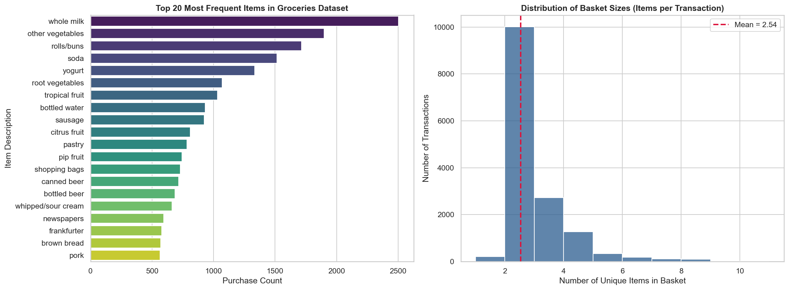
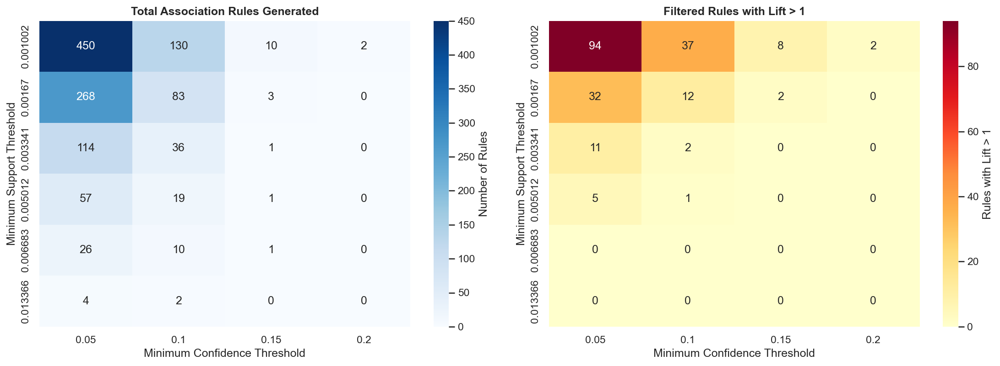
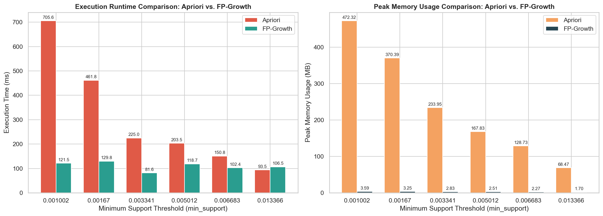
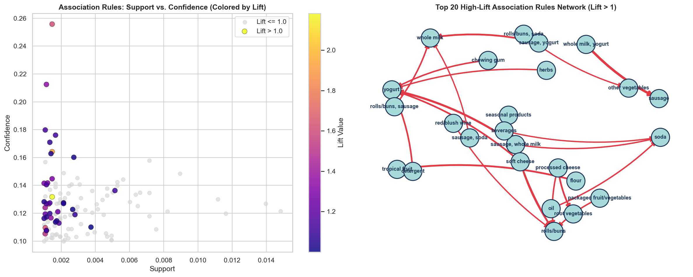

# Báo Cáo Thực Nghiệm Khai Phá Dữ Liệu: Supermarket Market Basket Analysis

**Môn học:** Khai phá dữ liệu (Data Mining)  
**Chủ đề:** I. Pattern Mining – Supermarket Market Basket Analysis  
**Dataset:** [Kaggle - Groceries Market Basket Dataset](https://www.kaggle.com/datasets/heeraldedhia/groceries-dataset)

---

## 1. Nhiệm vụ 1: Tiền xử lý & Chuyển đổi sang dạng Ma trận (Matrix Format)

* **Mã nguồn thực thi:**
  * `src/data_processing/loader.py`: Đọc dữ liệu gốc, làm sạch chuỗi ký tự và thống kê EDA.
  * `src/data_processing/matrix_builder.py`: Gom nhóm các mặt hàng theo tổ hợp `(Member_number, Date)` và mã hóa thành ma trận nhị phân Boolean (`14,963 × 167`) bằng `TransactionEncoder`.

| Chỉ số thống kê (EDA Metric) | Giá trị | Ý nghĩa đối với khai phá mẫu |
| :--- | :---: | :--- |
| Tổng số dòng giao dịch thô | `38,765` | Dữ liệu dạng *Single-item format* |
| Số dòng trùng lặp (`Member_number, Date, item`) | `759` | Được khử tự động khi đưa vào tập hợp `set()` |
| Tổng số giỏ hàng (`total_transactions`) | `14,963` | Số hàng của ma trận nhị phân |
| Tổng số mặt hàng (`unique_items`) | `167` | Số cột của ma trận nhị phân |
| Số mặt hàng trung bình / giỏ | `2.54` (Min: `1`, Max: `10`) | Giỏ hàng nhỏ -> cần đặt `min_support` thấp |
| Độ thưa của ma trận (Matrix Sparsity) | **`98.48%`** | Chỉ `1.52%` ô trong ma trận mang giá trị `True` |

---

## 2. Nhiệm vụ 2: Thực thi Apriori & FP-Growth với nhiều ngưỡng Support / Confidence

* **Mã nguồn thực thi:** `src/algorithms/apriori.py`, `src/algorithms/fpgrowth.py` & `src/algorithms/association_rules.py`
* **Bảng kết quả thực nghiệm đa ngưỡng (`outputs/tables/02_support_confidence_grid.csv`):**

| `min_support` | Tổng tập phổ biến | Tập có độ dài >= 2 | Khớp Apriori & FP-Growth | Số luật (`conf=0.05`) | Số luật (`conf=0.10`) | Số luật (`conf=0.15`) | Số luật (`conf=0.20`) | Số luật Lift > 1 (`conf=0.10`) |
| :---: | :---: | :---: | :---: | :---: | :---: | :---: | :---: | :---: |
| **`0.001`** | **750** | **601** | `True` | 450 | **130** | 10 | 2 | **37** (`Max Lift = 2.1829`) |
| **`0.002`** | **330** | **204** | `True` | 219 | **61** | 2 | 0 | **7** (`Max Lift = 1.1161`) |
| **`0.003`** | **216** | **105** | `True` | 131 | **39** | 1 | 0 | **2** (`Max Lift = 1.1161`) |
| **`0.005`** | **126** | **37** | `True` | 57 | **19** | 1 | 0 | **1** (`Max Lift = 1.1161`) |
| **`0.010`** | **69** | **5** | `True` | 10 | **4** | 0 | 0 | **0** (`Max Lift = 0.8229`) |

---

## 3. Nhiệm vụ 3: So sánh Hiệu năng Thực thi (Runtime & Memory Usage)

* **Mã nguồn thực thi:** `src/evaluation/benchmark.py`
* **Bảng kết quả đo lường (`outputs/tables/03_benchmark_apriori_vs_fpgrowth.csv`):**

| `min_support` | Số tập phổ biến | Apriori Runtime (ms) | FP-Growth Runtime (ms) | Tỷ lệ Tăng tốc (`Apriori / FP`) | Apriori Peak Memory (MB) | FP-Growth Peak Memory (MB) | Tỷ lệ Bộ nhớ (`Apriori / FP`) |
| :---: | :---: | :---: | :---: | :---: | :---: | :---: | :---: |
| **`0.001`** | 750 | 827.36 ms | **108.04 ms** | **7.66x** | 472.316 MB | **3.531 MB** | **133.76x** |
| **`0.002`** | 330 | 364.13 ms | **83.25 ms** | **4.37x** | 337.374 MB | **3.030 MB** | **111.34x** |
| **`0.003`** | 216 | 282.39 ms | **94.16 ms** | **3.00x** | 261.573 MB | **2.820 MB** | **92.76x** |
| **`0.005`** | 126 | 145.51 ms | **77.65 ms** | **1.87x** | 167.829 MB | **2.451 MB** | **68.47x** |
| **`0.010`** | 69 | **77.31 ms** | 83.40 ms | 0.93x | 86.460 MB | **1.870 MB** | **46.24x** |

---

## 4. Nhiệm vụ 4: Lọc Luật Lift > 1 & Chiến lược Cross-Selling / Store Layout

* **Mã nguồn thực thi:** `src/business_strategy/cross_selling.py` & `src/business_strategy/store_layout.py`
* **Bảng kết quả xuất ra:**
  * `outputs/tables/04_filtered_rules_lift_gt_1.csv`
  * `outputs/tables/05_cross_selling_recommendations.csv`
  * `outputs/tables/06_store_layout_recommendations.csv`

